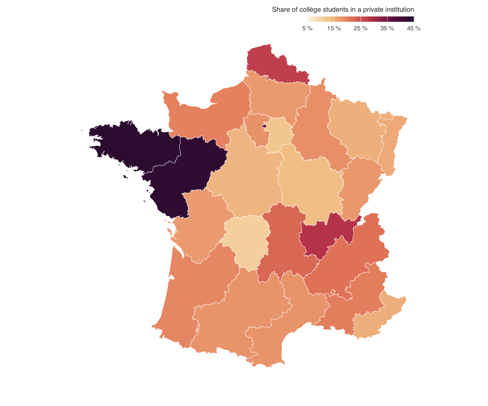
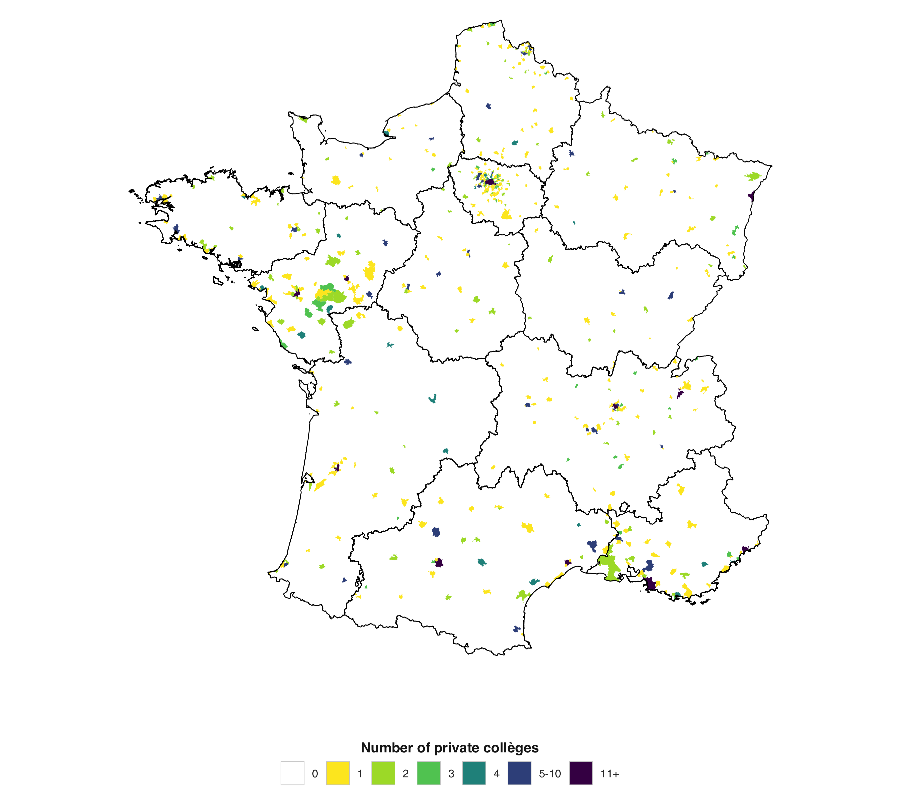
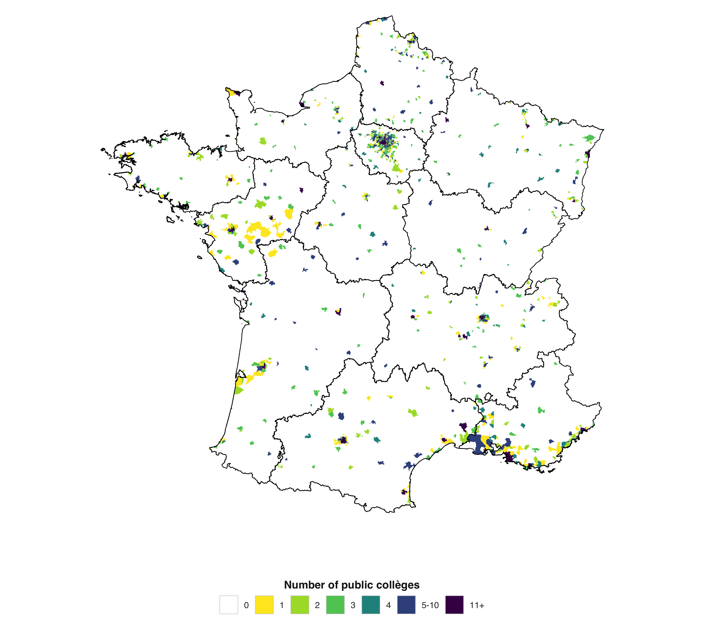

# Introduction

In 2025, 21% of French *collège* (lower-secondary) students are enrolled in a private school under contract with the State. This share varies substantially across *académies* (figure @fig-carte-colleges): in the Rennes *académie*, 43% of lower-secondary students attend a private institution, but the share drops to 11% in the Limoges *académie*.

::: {.callout-note collapse="true" title="Share of students passing the Brevet (last year of lower-secondary) from a private institution, by académie"}
{#fig-carte-colleges}
:::

One may think that this difference is linked with the social and economic composition of the city. But is it mostly linked with the **global level of inequality**, or with **spatial segregation**? Spatial segregation may already sort students by parental socio-economic status — a selection that private *collèges* sell on top of, reducing the need for them. Conversely, when segregation is intense, some streets are composed only of rich households and others only of poor ones, all assigned to the same public school, which increases the demand for private alternatives. **Which dimension of income inequality matters for the presence of private lower-secondary schools in a French city: its overall level, or its spatial segregation?**

We use French administrative data on *collèges* (Annuaire de l'éducation, IPS, added-value indicators) matched with income data at the 200 m grid-cell level (INSEE Filosofi). From Filosofi we build, **for each city (commune)**, indicators of inequality and segregation (Theil, Moran, exposure of the rich, polarization), then estimate count models of the number of private *collèges* per city, with controls and region-academy fixed effects. The unit of observation is the **city**, with the arrondissements of Paris, Lyon and Marseille merged into single cities (75056, 69123, 13055): the outcome is counted per commune, the Theil index decomposes exactly as $T_{\text{city}} = T_{\text{intra}} + T_{\text{inter}}$, and the spatial indices (Moran, exposure) are non-linear and cannot be averaged across arrondissements. This gives **N = 930 cities, of which N = 925 are used in the estimations** (5 cities dropped for missing values).

Peer effects give a theoretical rationale for private-school demand: if peers' behavior affects one's own performance, families seek schools with the best students, and private schools screen through tuition (*cream-skimming*; Epple and Romano, 1998; for a survey, Epple, Romano and Urquiola, 2015). What this literature does not address is the **spatial distribution of incomes within the city**: in France, public *collèges* are assigned through strict catchment areas, so the supply of private schools may depend on how segregated the catchment area is. Location models of private providers (Guimarães, Figueirdo and Woodward, 2003; Zhan, 2018; Koller and Welsch, 2017) stress the role of local demand — here, the local concentration of affluent households.

# Data

## Sources and pipeline

Four sources are matched:

1. **INSEE Filosofi (200 m grid)**: for each 200 m cell, population (`ind`), number of households (`men`), number of poor households (`men_pauv`), total income (`ind_snv`), with Lambert-93 coordinates. Cells are the atoms of the within-city spatial analysis.
2. **Annuaire de l'éducation nationale**: all *collèges* with status (public / private), contract type (under contract / hors contrat), and geographic coordinates.
3. **IPS collèges (AP 2023, DEPP)**: socio-economic index of each *collège*.
4. **Contours des académies (2020)** and **API geo.gouv.fr** for commune boundaries and region-academy codes.

The pipeline (R scripts "Code 2 v2" → "Code 2c" → "Code 3b" → "Code 4b v3" → "Code 7 v2" → "Code 9/10"):

- **Code 2 v2** computes, within each commune, the weighted inequality/segregation indicators on the Filosofi grid (neighborhood = cells within 285 m, i.e. the 8 adjacent 200 m cells, with a 4-NN fallback for isolated cells): weighted Gini/Theil/CV, dissimilarity, Moran's I (income and poverty) with permutation tests, LISA quadrants, etc.
- **Code 2c** adds the complementary indicators: exposure of the rich $P_{xx}$, entropy/diversity, Wolfson polarization, Getis-Ord, multidimensional segregation; all are z-scored.
- **Code 3b** counts the *collèges* per commune (public, private, private under contract, hors contrat), computes geographic controls (distance to nearest public *collège*, number of private *collèges* within 5 km in *other* communes), merges IPS, and produces `df_analyse_colleges.parquet`.
- **Code 4b v3** estimates the count models and saves `modeles_comptage.rds`.
- **Code 7 v2** runs the specification tests, cluster bootstrap, Monte Carlo and spatial diagnostics, and saves `code7.rds`.

**Regrouping of Paris, Lyon, Marseille.** The arrondissements are merged into one city per PLM city (`751xx → 75056`, `6938x → 69123`, `132xx → 13055`) at every step (Filosofi cells, college counts, centroids, IPS). This is required because $y$ is counted per commune, the Theil index decomposes exactly at the city level, and Moran/exposure are non-linear spatial indices that cannot be averaged over arrondissements.

## Variables and estimation sample

```{r setup-models, include=FALSE, message=FALSE, warning=FALSE}
library(arrow); library(dplyr); library(tidyr); library(sandwich)
library(lmtest); library(AER); library(pscl)
library(knitr); library(kableExtra); library(ggplot2)

os_name <- Sys.info()[["sysname"]]
DOSSIER_OUT <- if (os_name == "Windows")
  "C:/Users/camil/Documents/DepartementsPauvreteLycees" else
  "/Users/camillefavre/DepartementsPauvreteLycees"

d_raw <- read_parquet(file.path(DOSSIER_OUT, "df_analyse_colleges.parquet"))  # N = 930 villes
charg <- readRDS(file.path(DOSSIER_OUT, "modeles_comptage.rds"))
list2env(charg, envir = .GlobalEnv)          # d_mod, modeles, formules, tab_stab, tab_freq, vars_stab, ...
c7 <- tryCatch(readRDS(file.path(DOSSIER_OUT, "code7.rds")), error = function(e) NULL)
if (is.null(c7)) stop("code7.rds introuvable : relance le Code 7 v2 d'abord.")

m_p <- modeles$Poisson
N   <- nrow(d_mod)

pretty_reg <- c(auvergne_rhone_alpes = "Auvergne-Rhône-Alpes",
                bourgogne_franche_comte = "Bourgogne-Franche-Comté",
                bretagne = "Bretagne", centre_val_de_loire = "Centre-Val de Loire",
                corse = "Corse", grand_est = "Grand Est",
                hauts_de_france = "Hauts-de-France", ile_de_france = "Île-de-France",
                normandie = "Normandie", nouvelle_aquitaine = "Nouvelle-Aquitaine",
                occitanie = "Occitanie", pays_de_la_loire = "Pays de la Loire",
                provence_alpes_cote_azur = "Provence-Alpes-Côte d'Azur")

fmt_p <- function(p) ifelse(is.na(p), "--", ifelse(p < 0.001, "<0.001", sprintf("%.3f", p)))
stars <- function(p) ifelse(is.na(p), "", ifelse(p < 0.001, "***", ifelse(p < 0.01, "**",
                                                  ifelse(p < 0.05, "*", ""))))
lab_var <- c(z_theil = "Theil $T$ (z)", z_moran = "Moran $I$ (z)",
             z_exposition_riches = "Exposure $P_{xx}$ (z)", z_polarisation = "Polarization $W$ (z)",
             log_pop = "log population", log_rev = "log mean income",
             taux_pauv_commune = "Poverty rate (%)", nb_colleges_publics = "Public collèges",
             dist_college_public_km = "Dist. to public collège (km)",
             nb_prives_5km_autres = "Private collèges < 5 km, other cities")
vlab <- function(v) { v <- as.character(v); ifelse(v %in% names(lab_var), unname(lab_var[v]), v) }

V_cl   <- vcovCL(m_p, cluster = d_mod$region_acad, type = "HC1")
ct_p   <- coeftest(m_p, vcov. = V_cl)
m3     <- glm(formules$M3, family = poisson, data = d_mod)
lrt_fe <- anova(m3, m_p, test = "Chisq")
```

The dependent variable is the **number of private *collèges* per city** $y_i$ (`nb_colleges_prives`); maps @fig-carte-colleges-prives–@fig-carte-colleges-publics show its spatial distribution together with public *collèges*.

::: {.callout-note collapse="true" title="Number of collèges per commune"}
::: {.column-screen}
::: {layout-ncol="2" layout-valign="top"}
{#fig-carte-colleges-prives}

{#fig-carte-colleges-publics}
:::
:::
:::

```{r tbl-desc}
vars_m4 <- setdiff(all.vars(formules$M4), c("y", "region_acad"))
desc <- data.frame(
  Variable = vlab(vars_m4),
  Mean    = sprintf("%.2f", sapply(d_mod[, vars_m4], mean, na.rm = TRUE)),
  SD      = sprintf("%.2f", sapply(d_mod[, vars_m4], sd, na.rm = TRUE)),
  Min     = sprintf("%.2f", sapply(d_mod[, vars_m4], min, na.rm = TRUE)),
  Median  = sprintf("%.2f", sapply(d_mod[, vars_m4], median, na.rm = TRUE)),
  Max     = sprintf("%.2f", sapply(d_mod[, vars_m4], max, na.rm = TRUE)))
knitr::kable(desc, caption = paste0("Descriptive statistics of the M4 variables (N = ", N, " cities; Paris, Lyon and Marseille merged into single cities)."))
```

The distribution of $y$ is strongly zero-inflated and skewed:

```{r fig-distrib, fig.cap="Distribution of the number of private collèges per city."}
moy <- mean(d_mod$y); var_y <- var(d_mod$y); ratio <- var_y / moy; n0 <- sum(d_mod$y == 0)
distrib <- d_mod %>% filter(!is.na(y)) %>% count(n = y, name = "nb") %>%
  mutate(n = pmin(n, 5)) %>% group_by(n) %>% summarise(nb = sum(nb), .groups = "drop")
y_max <- max(distrib$nb)
ggplot(distrib, aes(x = n, y = nb)) +
  geom_col(fill = "#2c7fb8", width = 0.68) +
  geom_vline(xintercept = moy, linetype = "dashed", color = "#B4562A", linewidth = 0.55) +
  annotate("text", x = moy + 0.12, y = y_max * 0.97, label = sprintf("Mean = %.2f", moy),
           color = "#B4562A", hjust = 0, size = 3.6, fontface = "bold") +
  annotate("text", x = 4.95, y = y_max * 0.97, hjust = 1,
           label = sprintf("Variance = %.2f\nVar / Mean = %.2f\n%d%% of zeros", var_y, ratio, round(100*n0/N)),
           color = "#1a1a2e", size = 3.5, lineheight = 1.1, fontface = "bold") +
  scale_x_continuous(breaks = 0:5, labels = c("0","1","2","3","4","5+"),
                     expand = expansion(mult = c(0, 0.05))) +
  labs(x = "Number of private collèges per city", y = "Number of cities",
       subtitle = sprintf("N = %d cities · max = %d (Paris)", N, max(d_mod$y))) +
  theme_classic(base_size = 13) +
  theme(panel.grid.major.y = element_line(color = "grey88", linewidth = 0.3))
```

```{r tbl-reg}
reg <- as.data.frame(table(d_mod$region_acad)); names(reg) <- c("code", "n")
reg$Region <- unname(pretty_reg[as.character(reg$code)])
knitr::kable(reg[, c("Region", "n")], caption = paste0("Cities by region-academy (N = ", N, ")."))
```

# Methodology

## Income inequality and segregation indices at the city level

Filosofi provides 200 m grid cells with mean income, population, poverty rate, age structure, land-ownership, etc. A city is a network of cells, each having at most 8 neighbors (285 m neighborhood). We illustrate the construction on the real grid of Rennes.

::: {.callout-note collapse="true" title="Network of Rennes with 200 m cells"}
::: {#fig-carte-rennes-interactive}
<iframe src="reseau-rennes.html" width="100%" height="720"
        style="border:0; display:block; background:#0f0e0b;">
</iframe>

Rennes network of 200 m Filosofi grid cells (285 m neighbourhood). Interactive:
hover a cell for its characteristics, click to isolate its neighbourhood.
:::
:::

### The four indices

**Theil index (overall inequality).** For city $c$ with $N_c$ cells, mean income $\bar y_c$ and cell income $y_i$:

$$
T_c = \sum_{i=1}^{N_c} \omega_i\, r_i \ln r_i,
\qquad r_i = \frac{y_i}{\sum_j \omega_j y_j},
$$

where $\omega_i$ is the population share of cell $i$. $T_c = 0$ when all cells are equal; it is scale-invariant and decomposes exactly:

$$
T_c = \underbrace{\sum_g \omega_g T_g}_{\text{within-group}} + \underbrace{\sum_g \omega_g \ln(\bar y_g / \bar y_c)}_{\text{between-group}} .
$$

**Moran's I (spatial autocorrelation).** With the row-standardized weights $w_{ij} = 1$ if cells $i,j$ are within 285 m, and $z_i = y_i - \bar y_c$:

$$
I_c = \frac{N_c}{S_0}\,\frac{\sum_i \sum_j w_{ij} z_i z_j}{\sum_i z_i^2},
\qquad S_0 = \sum_i \sum_j w_{ij}.
$$

$I_c \to 1$ when similar incomes cluster (segregated), $\approx 0$ when spatially random, $\to -1$ for a checkerboard (Cliff and Ord, 1973; Anselin, 1995).

**Exposure of the rich, $P_{xx}$ (Massey and Denton, 1988).** A cell is rich if $y_i \ge Q_{75}(y)$; with $p_i^R = \omega_i \mathbb 1\{y_i \ge Q_{75}\}$ and $P^R = \sum_i p_i^R$:

$$
P_{xx,c} = \sum_i \frac{p_i^R}{P^R}\,
\frac{\sum_{j \in \mathcal N(i) \cup \{i\}} p_j^R}{\sum_{j \in \mathcal N(i) \cup \{i\}} \omega_j}
\;\in\; [0.25, 1],
$$

the probability that a rich household meets rich households in its immediate (closed) neighborhood — the relevant market base for a private *collège*.

**Polarization (Wolfson, 1994).**

$$
W_c = \frac{\lvert \bar y_c - \tilde y_c \rvert}{\sigma_c},
$$

with population-weighted median $\tilde y_c$ and standard deviation $\sigma_c$: $W_c$ grows as the distribution becomes bimodal (masses at both tails, thin middle class).

### The four indices applied to Rennes

```{r setup-rennes, message=FALSE, warning=FALSE}
#  echo: false
library(sf); library(spdep); library(dplyr)

os_name <- Sys.info()[["sysname"]]
dossier_donnees <- if (os_name == "Windows")
  "G:/Mon Drive/Education/Master APE 25-27/Mémoire/Données MicroMetrics/france_metro/" else
  "/Users/camillefavre/Mon Drive/Education/Master APE 25-27/Mémoire/Données MicroMetrics/france_metro/"

gpkg_path <- paste0(dossier_donnees, "carreaux_200m_met.gpkg")
CODE <- "35238"   # Rennes

rennes <- st_read(gpkg_path,
  query = sprintf("SELECT * FROM carreaux_200m_met WHERE lcog_geo LIKE '%s%%'", CODE),
  quiet = TRUE) %>%
  filter(is.finite(ind) & ind > 0 & is.finite(ind_snv)) %>%
  mutate(revenu = ind_snv / ind)                       # €/CU per cell
```

```{r rennes-theil-moran, message=FALSE, warning=FALSE}
#| echo: false
DIST_VOISIN <- 285; K_KNN <- 4
set.seed(2025)

weighted_theil <- function(x, w) {
  ok <- is.finite(x) & is.finite(w) & x > 0 & w > 0
  x <- x[ok]; w <- w[ok]; w <- w / sum(w)
  rel <- x / sum(w * x)
  sum(w * rel * log(rel))
}
weighted_median <- function(x, w) {
  ok <- is.finite(x) & is.finite(w) & w > 0
  x <- x[ok]; w <- w[ok]
  if (length(x) == 0) return(NA_real_)
  o <- order(x); x <- x[o]; w <- w[o]
  cw <- cumsum(w) / sum(w)
  x[which(cw >= 0.5)[1]]
}

xy <- st_coordinates(st_centroid(st_transform(rennes, 2154)))
nb <- dnearneigh(xy, d1 = 0, d2 = DIST_VOISIN)
if (any(card(nb) == 0)) {
  knnb <- as.list(knn2nb(knearneigh(xy, k = min(K_KNN, nrow(xy) - 1))))
  nbl  <- as.list(nb)
  for (j in which(card(nb) == 0)) nbl[[j]] <- knnb[[j]]
  nb <- structure(nbl, class = "nb", region.id = attr(nb, "region.id"), sym = attr(nb, "sym"))
}
lw <- nb2listw(nb, style = "W", zero.policy = TRUE)

y  <- rennes$revenu
wt <- rennes$ind
wn <- wt / sum(wt)

T_rennes    <- weighted_theil(y, wt)
ybar_rennes <- weighted.mean(y, wt)
rel_i     <- y / sum(wn * y)
contrib_i <- wn * rel_i * log(rel_i)

mi       <- moran.test(y, lw, zero.policy = TRUE, randomisation = TRUE)
I_rennes <- as.numeric(mi$estimate[1]); p_rennes <- mi$p.value

seuil_riches <- quantile(y, 0.75, na.rm = TRUE)
p_riche      <- ifelse(y >= seuil_riches, wt, 0)
P_R          <- sum(p_riche)
prop_riche_voisin <- sapply(seq_along(nb), function(i) {
  v <- c(i, nb[[i]]); sum(p_riche[v]) / sum(wt[v])
})
Pxx_rennes <- sum((p_riche / P_R) * prop_riche_voisin, na.rm = TRUE)

med_rennes <- weighted_median(y, wt)
sd_rennes  <- sqrt(sum(wn * (y - ybar_rennes)^2))
W_rennes   <- if (sd_rennes > 0) abs(ybar_rennes - med_rennes) / sd_rennes else NA_real_

z  <- as.numeric(scale(y))
wz <- lag.listw(lw, z, zero.policy = TRUE)
rennes$quadrant <- ifelse(wz >= 0, ifelse(z >= 0, "HH", "LH"),
                          ifelse(z >= 0, "HL", "LL"))
part_top5 <- sum(sort(contrib_i, decreasing = TRUE)[1:floor(0.05 * length(contrib_i))]) / T_rennes

# Orthogonality check: same incomes, permuted locations
set.seed(2025)
y_perm <- sample(y)
T_perm <- weighted_theil(y_perm, wt)
I_perm <- as.numeric(moran.test(y_perm, lw, zero.policy = TRUE)$estimate[1])
p_riche_perm <- ifelse(y_perm >= seuil_riches, wt, 0)
Pxx_perm <- sum((p_riche_perm / sum(p_riche_perm)) * prop_riche_voisin, na.rm = TRUE)
moy_perm <- weighted.mean(y_perm, wt); med_perm <- weighted_median(y_perm, wt)
sd_perm  <- sqrt(sum(wn * (y_perm - moy_perm)^2))
W_perm   <- if (sd_perm > 0) abs(moy_perm - med_perm) / sd_perm else NA_real_
```

The mean disposable income per consumption unit in Rennes is `r sprintf("%.0f", ybar_rennes)` € across `r nrow(rennes)` grid cells. The four indices are:
 | Index | Value | Interpretation |
 |---|---|---|
 | Theil $T$ | `r sprintf("%.4f", T_rennes)` | overall income dispersion |
 | Moran $I$ | `r sprintf("%.3f", I_rennes)` ($p = `r sprintf("%.3g", p_rennes)`$) | spatial clustering of incomes |
 | Exposure $P_{xx}$ | `r sprintf("%.3f", Pxx_rennes)` | spatial segregation of the rich (0.25 = mixed, 1 = ghetto) |
 | Polarization $W$ | `r sprintf("%.3f", W_rennes)` | bimodality of the distribution |

Three facts summarize the division of labor between the indices:

1. **Theil aggregates, the others locate or shape.** The 5% most contributing cells account for `r sprintf("%.1f", 100*part_top5)`% of the Theil index, but Theil is blind to *where* they are. Moran, $P_{xx}$ and $W$ detect structure: in the Moran scatterplot (@fig-moran-scatter), the slope of the fitted line *is* the Moran statistic; $P_{xx}$ quantifies whether the rich cluster together (the catchment base of a private *collège*); $W$ captures bimodality.
2. **The indices are orthogonal by construction.** Permuting incomes across cells leaves the distribution — hence $T$ — unchanged ($T = `r sprintf("%.4f", T_perm)`$), while Moran collapses to $I = `r sprintf("%.3f", I_perm)`$ and $P_{xx}$ to $`r sprintf("%.3f", Pxx_perm)`$; $W$ barely moves ($`r sprintf("%.3f", W_perm)`$), since it depends only on the shape of the distribution.
3. **In the count model, each coefficient captures a distinct mechanism**: $T$ → demand driven by the inequality level; $I$ → segregation within catchment areas; $P_{xx}$ → affluent market base targeted by private schools; $W$ → elite/poor split vs. homogeneous middle-class market.

::: {.callout-note collapse="true" title="Moran scatterplot of Rennes"}
```{r fig-moran-scatter, message=FALSE, warning=FALSE}
#| echo: false
#| fig-cap: "Moran scatterplot of Rennes: each point is a 200 m cell (x: its standardized income, y: the average standardized income of its neighbors). The slope is Moran's I; HH (top right) and LL (bottom left) are the clusters."
#| fig-width: 7
#| fig-height: 5.5
library(ggplot2)
df_scatter <- data.frame(z = z, wz = wz, quadrant = rennes$quadrant)
pal_quad <- c("HH" = "#2c7fb8", "LL" = "#b2182b", "HL" = "#8c8c8c", "LH" = "#8c8c8c")
ggplot(df_scatter, aes(x = z, y = wz, color = quadrant)) +
  geom_hline(yintercept = 0, color = "grey55", linewidth = 0.3) +
  geom_vline(xintercept = 0, color = "grey55", linewidth = 0.3) +
  geom_point(alpha = 0.55, size = 1.6) +
  geom_smooth(aes(color = NULL), method = "lm", se = FALSE, color = "#B4562A", linewidth = 0.8) +
  annotate("text", x = max(z)*0.55, y = max(wz)*0.9, label = "HH\nrich cluster",
           color = "#2c7fb8", fontface = "bold", size = 3.4) +
  annotate("text", x = min(z)*0.55, y = min(wz)*0.9, label = "LL\npoor cluster",
           color = "#b2182b", fontface = "bold", size = 3.4) +
  annotate("text", x = -max(abs(z))*0.75, y = max(wz)*0.55,
           label = paste0("slope = Moran I = ", sprintf("%.3f", I_rennes),
                          "\nPxx = ", sprintf("%.3f", Pxx_rennes),
                          "\nW = ", sprintf("%.3f", W_rennes)),
           color = "#B4562A", fontface = "bold", size = 3.8, hjust = 0) +
  scale_color_manual(values = pal_quad, guide = "none") +
  labs(x = expression("Standardized cell income " ~ z[i]),
       y = expression("Avg. standardized income of neighbors " ~ sum(j, w[ij]*z[j]))) +
  coord_cartesian(xlim = range(z)*1.05, ylim = range(wz)*1.05) +
  theme_classic(base_size = 12)
```
:::

## Count data models

The outcome $y_i \in \{0,1,2,\dots\}$ is a count, so we estimate count models for the conditional mean $\mu_i = \exp(x_i'\beta)$ by maximum likelihood.

**Poisson.** 
$$
\mathbb P(y_i = k \mid x_i) = \frac{e^{-\mu_i}\mu_i^k}{k!},
\qquad
\ell(\theta) = \sum_i \left[ y_i \ln \mu_i - \mu_i - \ln(y_i!) \right],
\qquad \mu_i = \exp(x_i'\theta),
$$
with $\mathbb E(y_i) = \mathbb V(y_i) = \mu_i$. Coefficients are reported as **IRR** $= e^{\beta_k}$: a one-unit increase in $x_k$ multiplies the expected count by $e^{\beta_k}$. Because the model is non-linear, we also report **average marginal effects (AME)**, computed by finite differences on the response scale:
$$
\mathrm{AME}_k = \frac{1}{n}\sum_i \left[ \mu(x_{ik} + h/2, x_{i,-k}) - \mu(x_{ik} - h/2, x_{i,-k}) \right]/h .
$$

**Specification tests.** Cameron and Trivedi (1990) test $H_0: \mathbb V(y_i) = \mu_i$ against $\mathbb V(y_i) = \mu_i + \alpha g(\mu_i)$ with the auxiliary OLS regression
$$
(y_i - \hat\mu_i)^2 - y_i = \alpha\, g(\hat\mu_i) + \varepsilon_i ,
$$
using $g(\mu) = \mu$ or $g(\mu) = \mu^2$ (the latter nests NB2); the Poisson MLE of $\mu$ stays consistent under variance misspecification (Gourieroux, Monfort and Trognon, 1984). Van den Broek (1995) tests for **excess zeros**:
$$
z = \frac{n_0 - \sum_i \hat p_{i0}}{\sqrt{\sum_i \hat p_{i0}(1 - \hat p_{i0})}},
\qquad \hat p_{i0} = e^{-\hat\mu_i}.
$$
Non-nested models are compared with the **Vuong (1989)** statistic:
$$
V = \frac{\sum_i m_i}{\sqrt{n}\,\mathrm{sd}(m_i)},
\qquad m_i = \ln f_{\text{hurdle}}(y_i) - \ln f_{\text{Poisson}}(y_i),
$$
positive when the hurdle model fits better observation by observation.

**Negative binomial (NB2).** Adding a gamma frailty $u_i \sim \Gamma(\alpha,\alpha)$ (Greenwood and Yule, 1920) gives
$$
\mathbb P(y_i = k \mid x_i) = \frac{\Gamma(k + 1/\alpha)}{\Gamma(k+1)\Gamma(1/\alpha)}
\left(\frac{\mu_i}{\mu_i + 1/\alpha}\right)^k \left(\frac{1/\alpha}{\mu_i + 1/\alpha}\right)^{1/\alpha},
\qquad \mathbb V(y_i) = \mu_i\left(1 + \tfrac{\mu_i}{\alpha}\right).
$$

**Hurdle model (Mullahy, 1986; Long, 1997).** Two-part DGP: a zero part $\pi_i = F(-z_i'\gamma)$ (probability of *no* private school — a different process, e.g. no local demand) and a count part for $y_i > 0$, which is the **zero-truncated** count distribution:
$$
\ell_i =
\begin{cases}
\ln \pi_i, & y_i = 0,\\[4pt]
\ln(1 - \pi_i) + \ln f_{\text{count}}(y_i) - \ln\!\big(1 - f_{\text{count}}(0)\big), & y_i > 0.
\end{cases}
$$

**Zero-inflated (ZINB, Lambert, 1992).** A zero can come from the zero part *or* from the count part:
$$
\ell_i =
\begin{cases}
\ln\!\big[\pi_i + (1-\pi_i) f_{\text{count}}(0)\big], & y_i = 0,\\
\ln(1 - \pi_i) + \ln f_{\text{count}}(y_i), & y_i > 0.
\end{cases}
$$

## Specifications and fixed effects

We estimate a sequence of nested Poisson specifications (table @tbl-spec):

- **(M0)** $\mu_i = \exp(\beta_1\, z_{\text{theil},i})$
- **(M1)** M0 $+ \beta_2 \log(\text{pop}_i)$
- **(M2)** (M1) \(+\ \beta_3\, z_{\text{moran},i} + \beta_4 \log(\texttt{rev}_i) + \beta_5\, \texttt{pauv}_i + \beta_6\, \texttt{pub}_i + \beta_7\, \texttt{dist}_i + \beta_8\, \texttt{priv5km}_i\)
- **(M3)** M2 $+ z_{\text{expo},i} + z_{\text{pol},i}$ (all four indices)
- **(M3b)** controls $+ z_{\text{moran}} + z_{\text{expo}} + z_{\text{pol}}$ (without Theil)
- **(M4)** M3 $+ \alpha_{r(i)}$, region-academy fixed effects (13 modalities)

Controls: log mean income (`log_rev`), communal poverty rate (`taux_pauv`), number of public *collèges* (`nb_pub`), distance to the nearest public *collège* in km (`dist_pub`), number of private *collèges* within 5 km in **other** cities (`priv5km`).

```{r tbl-spec}
mods <- intersect(c("M0","M1","M2","M3","M3b","M4"), names(formules))
allv <- setdiff(unique(unlist(lapply(formules[mods], all.vars))), c("y", "region_acad"))
ord <- c("z_theil","z_moran","z_exposition_riches","z_polarisation","log_pop","log_rev",
         "taux_pauv_commune","nb_colleges_publics","dist_college_public_km","nb_prives_5km_autres")
allv <- c(intersect(ord, allv), setdiff(allv, ord))
spec <- data.frame(Variable = vlab(allv), check.names = FALSE)
for (m in mods) spec[[m]] <- ifelse(allv %in% all.vars(formules[[m]]), "×", "--")
aic_mods <- sapply(mods, function(m) AIC(glm(formules[[m]], family = poisson, data = d_mod)))
aic_row <- data.frame(Variable = "AIC (Poisson)", check.names = FALSE)
fe_row  <- data.frame(Variable = "Region-academy FE", check.names = FALSE)
for (m in mods) { aic_row[[m]] <- sprintf("%.1f", aic_mods[m])
                  fe_row[[m]]  <- if (m == "M4") "×" else "--" }
spec <- rbind(spec, aic_row, fe_row)
knitr::kable(spec, align = paste0("l", strrep("c", length(mods))),
             caption = paste0("Nested specifications M0–M4 (Poisson, log link), N = ", N, " cities."))
```

The joint significance of the fixed effects is tested with a **likelihood-ratio test** (more reliable than a Wald test with cluster-robust covariance here):
$$
2\big(\ell_{M4} - \ell_{M3}\big) \;\sim\; \chi^2(12),
\qquad
2(\ell_{M4}-\ell_{M3}) = `r sprintf("%.1f", lrt_fe$Deviance[2])` ,\quad p `r fmt_p(lrt_fe[["Pr(>Chi)"]][2])`.
$$

```{r fig-fe, message=FALSE, warning=FALSE}
#| fig-cap: "Region-academy fixed effects of the Poisson M4 specification, with 95% cluster-robust confidence intervals (reference = Auvergne-Rhône-Alpes)."
#| fig-width: 7
#| fig-height: 5
beta_fe <- coef(m_p)[grepl("^region_acad", names(coef(m_p)))]
V_sub   <- V_cl[names(beta_fe), names(beta_fe)]
fe_ci <- data.frame(region = unname(pretty_reg[sub("^region_acad", "", names(beta_fe))]),
                    coef = beta_fe, se = sqrt(diag(V_sub))) %>%
  mutate(icb = coef - 1.96*se, ich = coef + 1.96*se,
         region = factor(region, levels = region[order(coef)]))
ggplot(fe_ci, aes(coef, region)) +
  geom_vline(xintercept = 0, linetype = "dashed", color = "grey50") +
  geom_pointrange(aes(xmin = icb, xmax = ich)) +
  labs(x = "Fixed effect (log scale)", y = NULL) +
  theme_minimal(base_size = 11) + theme(panel.grid.minor = element_blank())
```

## Inference and diagnostics

- **Cluster-robust standard errors**: $\hat V = (X'X)^{-1}\big(\sum_g X_g' \hat u_g \hat u_g' X_g\big)(X'X)^{-1}$ with HC1 correction, clustered by **region-academy** (Wooldridge, 2010).
- **Cluster bootstrap** (B = 500) for the difference $\beta_{z_{\text{expo}}}(M4) - \beta_{z_{\text{expo}}}(M3)$.
- **Monte Carlo** (M = 200): simulate $y$ under a Poisson DGP and under an NB2 DGP (size = 1.5) with the M4 design and $\beta^* = `r c7$beta_star`$ on `r c7$PARAM`; re-estimate Poisson and NB2; compare bias, empirical SD, average SE and 95% coverage.
- **Spatial diagnostics**: Moran's I on the M4 residuals (8-NN weights), a SAR model (`lagsarlm`, $\rho$), and spatial-block cross-validation (k-means, k = 10) vs. random CV.
- **Reverse regression** (endogeneity check): OLS of each segregation index on $y$ + controls ± FE, cluster-robust SE.

# Results

```{r tbl-coefM4}
ct_num <- data.frame(Variable = rownames(ct_p), beta = ct_p[,1], se = ct_p[,2], z = ct_p[,3],
                     p = ct_p[,4], IRR = exp(ct_p[,1]),
                     icb = exp(ct_p[,1] - 1.96*ct_p[,2]), ich = exp(ct_p[,1] + 1.96*ct_p[,2]))
fmt_coef <- function(d) data.frame(
  Variable = ifelse(d$Variable == "(Intercept)", "Intercept",
             ifelse(startsWith(d$Variable, "region_acad"),
                    paste0("FE ", pretty_reg[sub("^region_acad", "", d$Variable)]), vlab(d$Variable))),
  beta = sprintf("%.4f", d$beta), SE = sprintf("%.4f", d$se), z = sprintf("%.2f", d$z),
  p = fmt_p(d$p), IRR = sprintf("%.3f", d$IRR),
  IC95 = paste0("[", sprintf("%.3f", d$icb), " ; ", sprintf("%.3f", d$ich), "]"))
hf <- ct_num[!grepl("^region_acad", ct_num$Variable), ]
knitr::kable(fmt_coef(hf),
  caption = paste0("Poisson M4, coefficients (cluster-robust SE by region-academy, HC1; N = ", N,
                   "). LRT of the FE (M3 vs M4): χ²(", lrt_fe$Df[2], ") = ",
                   sprintf("%.1f", lrt_fe$Deviance[2]), ", p ", fmt_p(lrt_fe[["Pr(>Chi)"]][2]), "."))
```

```{r tbl-feM4}
fe <- ct_num[grepl("^region_acad", ct_num$Variable), ]; fe <- fe[order(-fe$IRR), ]
knitr::kable(fmt_coef(fe),
  caption = "Poisson M4: region-academy fixed effects, sorted by decreasing IRR (reference = Auvergne-Rhône-Alpes).")
```

In M4, the **spatial structure** of segregation is what matters: `r sprintf("%.4f", coef(m_p)["z_moran"])` on Moran's I (IRR `r sprintf("%.3f", exp(coef(m_p)["z_moran"]))`, 95% CI `r sprintf("[%.3f ; %.3f]", exp(coef(m_p)["z_moran"] - 1.96*ct_p["z_moran","Std. Error"]), exp(coef(m_p)["z_moran"] + 1.96*ct_p["z_moran","Std. Error"]))`, p `r fmt_p(ct_p["z_moran","Pr(>|z|)"])`): +1 SD of spatial clustering of incomes is associated with **+13.4%** more private *collèges*. The **overall level** of inequality (Theil) is **not significant** once population size is controlled (p = `r fmt_p(ct_p["z_theil","Pr(>|z|)"])`) — see the stability table below. Polarization is negative (IRR `r sprintf("%.3f", exp(coef(m_p)["z_polarisation"]))`, p = `r fmt_p(ct_p["z_polarisation","Pr(>|z|)"])`), exposure is not significant. Controls behave as expected: population elasticity `r sprintf("%.3f", coef(m_p)["log_pop"])` (≈ proportional), log mean income +`r sprintf("%.2f", coef(m_p)["log_pop"])`-scale effect, poverty rate +`r sprintf("%.4f", coef(m_p)["taux_pauv_commune"])` per point, and each private *collège* within 5 km in neighboring cities is associated with `r sprintf("%.4f", coef(m_p)["nb_prives_5km_autres"])` fewer private *collèges* in the city (p `r fmt_p(ct_p["nb_prives_5km_autres","Pr(>|z|)"])`) — a market/crowding effect.

```{r tbl-stab}
mods_stab <- intersect(mods, unique(tab_stab$modele))
stab <- data.frame(Variable = vlab(vars_stab), check.names = FALSE)
for (m in mods_stab) {
  sel <- tab_stab$modele == m
  cf <- tab_stab$coef[sel][match(vars_stab, tab_stab$variable[sel])]
  pp <- tab_stab$p[sel][match(vars_stab, tab_stab$variable[sel])]
  stab[[m]] <- ifelse(is.na(cf), "--", paste0(sprintf("%.4f", cf), stars(pp)))
}
knitr::kable(stab, align = paste0("l", strrep("c", length(mods_stab))),
  caption = "Segregation coefficients across specifications (*** p<0.001, ** p<0.01, * p<0.05). Theil: significant in M0, absorbed by log population from M1 on. Moran: stable and significant from M2 on.")
```

```{r tbl-aic}
aics <- sapply(modeles, AIC)
nb2_deg <- !is.finite(modeles$NB2$theta) || modeles$NB2$theta > 1e6
aics_ok <- aics; if (nb2_deg) aics_ok["NB2"] <- NA_real_
best <- names(which.min(aics_ok))
ta <- data.frame(Model = names(modeles), AIC = sprintf("%.1f", aics),
                 BIC = sprintf("%.1f", sapply(modeles, BIC)),
                 logLik = sprintf("%.1f", sapply(modeles, logLik)))
knitr::kable(ta, caption = paste0("Information criteria. NB2 is degenerate (θ → ∞: coefficients collapse to Poisson, its AIC is a numerical artefact). Best model: ", best, " (AIC = ", sprintf("%.1f", aics_ok[best]), ")."))
```

```{r tbl-freq}
tf <- as.data.frame(tab_freq)
if (!"y" %in% names(tf)) tf <- data.frame(y = rownames(tab_freq), tf, check.names = FALSE)
tf[] <- lapply(tf, function(x) if (is.numeric(x)) sprintf("%.1f", x) else x)
knitr::kable(tf, caption = "Observed vs predicted frequencies (y = 0 to 8+). Zeros: 362 observed; Hurdle-Poisson predicts 362.0, Poisson 406.5, ZINB 414.5. NB2 column = Poisson (degenerate).")
```

```{r tbl-ame}
ame_num <- function(m, data, var, h = 0.01) {
  d1 <- data; d0 <- data
  d1[[var]] <- d1[[var]] + h/2; d0[[var]] <- d0[[var]] - h/2
  mean((predict(m, d1, type = "response") - predict(m, d0, type = "response"))/h)
}
vars_ame <- intersect(vars_stab, all.vars(formules$M4))
tame <- data.frame(Variable = vlab(vars_ame),
                   AME = sprintf("%.4f", sapply(vars_ame, ame_num, m = m_p, data = d_mod)))
knitr::kable(tame, caption = "Average marginal effects, M4 (finite difference h = 0.01): change in the expected number of private collèges per city for +1 SD of the index.")
```

The AME of Moran's I is `r sprintf("%.4f", sapply("z_moran", ame_num, m = m_p, data = d_mod))` private *collèges* per city for +1 SD — the economically meaningful magnitude (raw coefficients of a log-link model are not marginal effects).

# Extensions and robustness

## Specification tests

```{r tbl-spectests, echo=FALSE, warning=FALSE, message=FALSE}
#  tbl-cap: "Tests de spécification sur le Poisson M4 (N = 925). CT : surdispersion ; Van den Broek : probabilité de zéro (versions cluster-robustes lues dans code7.rds) ; Vuong : Hurdle vs Poisson."

rob <- if (!is.null(c7)) c7$vdB_rob else NULL
h   <- modeles$Hurdle_Pois
m_p <- modeles$Poisson
d   <- d_mod

# --- Vuong, recalculé avec termes clampés (plus de NaN) ---
mu_p <- fitted(m_p)
mu_h <- pmax(predict(h, type = "count"), 1e-10)
pi_h <- pmin(pmax(predict(h, type = "zero"), 1e-10), 1 - 1e-10)
ll_p <- dpois(d$y, mu_p, log = TRUE)
ll_h <- ifelse(d$y == 0, log(pi_h),
               log(1 - pi_h) + dpois(d$y, mu_h, log = TRUE) - log(1 - dpois(0, mu_h)))
m_i <- ll_p - ll_h                      # convention : m < 0 = Hurdle préféré
vuong_stat <- sum(m_i) / (sqrt(nrow(d)) * sd(m_i))
vuong_p    <- 2 * pnorm(-abs(vuong_stat))

# --- Van den Broek : depuis code7.rds (vdB_rob), sinon recalcul iid ---
if (!is.null(rob)) {
  z_iid  <- rob$iid[["z"]];   p_iid  <- rob$iid[["p"]]
  z_acad <- rob$acad[["z"]];  p_acad <- rob$acad[["p"]]
  z_dept <- rob$dept[["z"]];  p_dept <- rob$dept[["p"]]
  z_blk  <- if (!is.null(rob$block)) rob$block[["z"]] else NA_real_
  p_blk  <- if (!is.null(rob$block)) rob$block[["p"]] else NA_real_
  pw_acad <- if (!is.null(rob$wild_acad))  rob$wild_acad[["p_wild"]]  else NA_real_
  pw_dept <- if (!is.null(rob$wild_dept))  rob$wild_dept[["p_wild"]]  else NA_real_
  pw_blk  <- if (!is.null(rob$wild_block)) rob$wild_block[["p_wild"]] else NA_real_
} else {
  p0 <- dpois(0, mu_p); n0 <- sum(d$y == 0)
  z_iid <- (n0 - sum(p0)) / sqrt(sum(p0 * (1 - p0))); p_iid <- 2 * pnorm(-abs(z_iid))
  z_acad <- p_acad <- z_dept <- p_dept <- z_blk <- p_blk <- NA_real_
  pw_acad <- pw_dept <- pw_blk <- NA_real_
}

# alias pour le texte inline après le chunk
z_vdb <- z_iid
p_vdb <- p_iid

f3    <- function(x) ifelse(is.na(x), "--", sprintf("%.3f", x))
fmtp2 <- function(p) ifelse(is.na(p), "--", ifelse(p < 0.001, "< 0.001", sprintf("%.3f", p)))

ct2 <- AER::dispersiontest(m_p, trafo = 2)   # NB2 : z = -0.686, p = 0.754 (unilatéral)
ct1 <- AER::dispersiontest(m_p, trafo = 1)   # NB1 : z = -3.779, p = 1.000

tab <- data.frame(
  Test = c("Cameron-Trivedi, trafo = 2 (NB2) : z",
           "Cameron-Trivedi, trafo = 1 (NB1) : z",
           "Van den Broek (iid)",
           "VdB cluster académie (G = 13)",
           "VdB cluster département (G = 96)",
           "VdB blocs spatiaux k-means, k = 10",
           "VdB wild cluster bootstrap B = 2000 (académies)",
           "VdB wild bootstrap (départements)",
           "VdB wild bootstrap (blocs spatiaux)",
           "Vuong Hurdle-Pois vs Poisson"),
  Statistique = c(f3(ct2$statistic), f3(ct1$statistic), f3(z_iid), f3(z_acad), f3(z_dept),
                  f3(z_blk), "--", "--", "--", f3(vuong_stat)),
  p = c(fmtp2(ct2$p.value), fmtp2(ct1$p.value), fmtp2(p_iid), fmtp2(p_acad), fmtp2(p_dept),
        fmtp2(p_blk), fmtp2(pw_acad), fmtp2(pw_dept), fmtp2(pw_blk), fmtp2(vuong_p)),
  stringsAsFactors = FALSE
)
knitr::kable(tab, format = "pipe", align = "lrr")
```

The raw Var/Mean ratio is `r sprintf("%.2f", var(d_mod$y)/mean(d_mod$y))`, but it is driven by the zero mass and by between-city heterogeneity in $\mu$ (the Paris outlier): the Cameron–Trivedi test on the fitted M4 does **not** reject equidispersion ($z = `r sprintf("%.3f", ct2$statistic)`$, $p = `r fmt_p(ct2$p.value)`$; $\hat\alpha \approx -0.008$), which is why NB2 degenerates ($\theta \to \infty$, an AIC artifact). The real problem is the **zero probability**: the Van den Broek test rejects $H_0$ ($z = `r sprintf("%.3f", z_vdb)`$, $p = `r fmt_p(p_vdb)`$ in the iid version; the cluster-robust versions — académies, départements, spatial blocks — and the wild cluster bootstrap with $B = 2000$ all reject as well, see Table @tbl-spectests), and the Vuong test strongly prefers the hurdle over the plain Poisson ($V = `r sprintf("%.2f", vuong_stat)`$, $p = `r fmt_p(vuong_p)`$; convention $m = \ell_{\mathrm{Poisson}} - \ell_{\mathrm{Hurdle}}$, so $V < 0$ means the hurdle is preferred) — consistent with the AIC (Table @tbl-aic) and with the fact that the hurdle-Poisson model predicts the 362 observed zeros exactly (Table @tbl-freq).

## Bootstrap of the FE effect on the segregation coefficients

```{r tbl-boot}
tb <- c7$tab_boot
tb2 <- data.frame(Estimator = tb$estimateur, Delta = sprintf("%.4f", tb$diff),
                  SE = sprintf("%.4f", tb$se), IC95_low = sprintf("%.4f", tb$ic_bas),
                  IC95_high = sprintf("%.4f", tb$ic_haut), p = fmt_p(tb$p))
knitr::kable(tb2, caption = "β_zexposition(M4) − β_zexposition(M3): delta method vs cluster bootstrap (B = 500, clusters = region-academies).")
```

The change in the exposure coefficient when the regional FE are added is `r sprintf("%.4f", tb$diff[1])` and is **not significant** (delta p = `r fmt_p(tb$p[1])`, bootstrap p = `r fmt_p(tb$p[2])`): the fixed effects absorb regional heterogeneity but do not confound the segregation coefficients.

## Monte Carlo

```{r tbl-mc}
tm <- as.data.frame(c7$tab_mc)
tm2 <- data.frame(DGP = tm$dgp, Estimator = tm$estimateur,
                  Bias = ifelse(is.na(tm$biais), "--", sprintf("%.4f", tm$biais)),
                  SD_emp = ifelse(is.na(tm$sd_emp), "--", sprintf("%.4f", tm$sd_emp)),
                  SE_mean = ifelse(is.na(tm$mean_se), "--", sprintf("%.4f", tm$mean_se)),
                  Coverage = ifelse(is.na(tm$couv95), "--", sprintf("%.3f", tm$couv95)))
knitr::kable(tm2, caption = paste0("Monte Carlo: bias, empirical SD, average SE, 95% coverage (M = 200 replications; parameter tracked: ",
                                   c7$PARAM, ", β* = ", c7$beta_star, " on the M4 design)."))
```

Under a Poisson DGP, the Poisson estimator is unbiased (bias ≈ 0) and its SEs are nearly calibrated (coverage ≈ 0.93). Under an NB2 DGP (size = 1.5), the Poisson estimator stays unbiased but its **model-based SEs are too small** (empirical SD 0.083 vs average SE 0.043, coverage 0.72): this is exactly why we use **cluster-robust SEs**. NB2 under NB2 covers correctly (0.945). Under a pure Poisson DGP, NB2 cannot identify $\theta$ (all 200 replications fail to converge), consistent with the degenerate NB2 on the real data.

## Spatial diagnostics

```{r tbl-spatial}
rho_v <- unname(coef(c7$m_sar)["rho"]); rho_p <- c7$sar_rho["p"]
ratio_cv <- c7$tab_cv$mse[2] / c7$tab_cv$mse[1]
mor <- data.frame(
  Indicator = c("Moran I of M4 residuals (8-NN, W weights)",
                "MSE, spatial-block CV (k-means, k = 10)",
                "MSE, random CV (10%, 20 reps)",
                "SAR ρ (lagsarlm, 8-NN)"),
  Value = c(sprintf("%.4f", c7$moran$estimate[1]), sprintf("%.3f", c7$tab_cv$mse[1]),
            sprintf("%.3f", c7$tab_cv$mse[2]), sprintf("%.4f", rho_v)),
  p = c(fmt_p(c7$moran$p.value), "--", "--", fmt_p(rho_p)))
knitr::kable(mor, caption = paste0("Spatial diagnostics. Random-CV MSE / spatial-block-CV MSE = ",
  sprintf("%.2f", ratio_cv), ": the random CV is dominated by the Paris outlier (y = 103) when it falls in the test fold; the spatial-block CV is the relevant validation (no spatial leakage)."))
```

Residual spatial autocorrelation is significant (Moran I = `r sprintf("%.4f", c7$moran$estimate[1])`, p `r fmt_p(c7$moran$p.value)`) — hence the cluster-robust SEs. In the SAR model, $\rho = `r sprintf("%.4f", rho_v)`$ (p = `r fmt_p(rho_p)`$): once the regional FE and controls are included, the spatial lag is only marginally significant and slightly negative, i.e. most of the spatial dependence is absorbed at the regional level.

## Reverse regression (endogeneity check)

```{r tbl-revreg}
ctrl <- c("log_pop","log_rev","taux_pauv_commune","nb_colleges_publics",
          "dist_college_public_km","nb_prives_5km_autres")
outcomes <- c("z_exposition_riches","z_theil","z_polarisation","z_moran")
rows <- list()
for (v in outcomes) {
  f_base <- paste(v, "~ y +", paste(ctrl, collapse = " + "))
  for (fe in c(FALSE, TRUE)) {
    m <- lm(as.formula(if (fe) paste(f_base, "+ region_acad") else f_base), data = d_mod)
    ct <- coeftest(m, vcov. = vcovCL(m, cluster = d_mod$region_acad, type = "HC1"))
    rows[[length(rows)+1]] <- data.frame(Outcome = vlab(v), FE = if (fe) "yes" else "no",
      beta_y = ct["y","Estimate"], SE = ct["y","Std. Error"], t = ct["y","t value"],
      p = ct["y","Pr(>|t|)"], R2 = summary(m)$r.squared)
  }
}
tab_rev <- do.call(rbind, rows)
knitr::kable(tab_rev %>%
               mutate(beta_y = sprintf("%.4f", beta_y), SE = sprintf("%.4f", SE),
                      t = sprintf("%.2f", t), p = fmt_p(p), R2 = sprintf("%.3f", R2)),
  caption = paste0("Reverse regressions: segregation index ~ y + controls (± region-academy FE). OLS, cluster-robust SE (region-academy, HC1), N = ", N, ". Tests reverse causality / simultaneity."))
```

## Robustness of the four segregation coefficients

```{r tbl-cor}
vars4 <- c("z_theil","z_moran","z_exposition_riches","z_polarisation")
knitr::kable(round(cor(d_mod[, vars4]), 3),
             caption = paste0("Correlation matrix of the four segregation indices (N = ", N, ")."))
```

```{r tbl-robust}
vars4 <- c("z_theil","z_moran","z_exposition_riches","z_polarisation")

# extraction sûre variable par variable (évite subscript out of bounds si absent du modèle)
fit_row <- function(m, data, label, vcov_mat = NULL) {
  ct <- if (is.null(vcov_mat)) coeftest(m, vcov. = vcovCL(m, cluster = as.character(data$region_acad), type = "HC1")) else coeftest(m, vcov. = vcov_mat)
  do.call(rbind, lapply(vars4, function(v) {
    if (v %in% rownames(ct))
      data.frame(Spec = label, Variable = vlab(v), beta = sprintf("%.4f", ct[v, 1]),
                 SE = sprintf("%.4f", ct[v, 2]), p = fmt_p(ct[v, 4]), stringsAsFactors = FALSE)
    else
      data.frame(Spec = label, Variable = vlab(v), beta = "(not in model)", SE = "--", p = "--",
                 stringsAsFactors = FALSE)
  }))
}

d_sans <- d_mod[!as.character(d_mod$code_insee) %in% c("75056","69123","13055"), ]
r_sans_plm   <- fit_row(glm(formules$M4, family = poisson, data = d_sans), d_sans,
                        "M4 without Paris/Lyon/Marseille")
r_sans_moran <- fit_row(glm(update(formules$M4, . ~ . - z_moran), family = poisson, data = d_mod),
                        d_mod, "M4 without z_moran")
d_alt <- d_mod[!is.na(d_mod$nb_prives_sous_contrat), ]
r_sous <- fit_row(glm(update(formules$M4, nb_prives_sous_contrat ~ .), family = poisson, data = d_alt),
                  d_alt, "M4, y = private under contract")
r_dept <- fit_row(m_p, d_mod, "M4, cluster = département",
                  vcov_mat = vcovCL(m_p, cluster = as.character(d_mod$dept), type = "HC1"))

# Hurdle-Pois, composante count (robuste au format de stockage des coefs pscl)
h <- modeles$Hurdle_Pois
cc <- tryCatch(h$coefficients$count, error = function(e) {
  v <- coef(h)
  if (is.list(v)) return(v$count)
  w <- v[grepl("^count\\.", names(v))]
  names(w) <- sub("^count\\.", "", names(w))
  w
})
r_hurdle <- data.frame(Spec = "Hurdle-Pois, count part", Variable = vlab(vars4),
                       beta = "--", SE = "--", p = "--", stringsAsFactors = FALSE)
vh <- intersect(vars4, names(cc))
r_hurdle[match(vh, vars4), "beta"] <- sprintf("%.4f", cc[vh])

rob <- rbind(r_sans_plm, r_sans_moran, r_sous, r_dept, r_hurdle)
knitr::kable(rob, caption = "The four segregation coefficients across alternative specifications (cluster-robust SE, HC1).")
```
# Discussion

The results point to a clear mechanism: **it is the spatial structure of segregation, not the overall level of inequality, that is associated with the supply of private *collèges***. Theil is strongly positive in the naive M0 (`r sprintf("%.4f", tab_stab$coef[tab_stab$modele=="M0" & tab_stab$variable=="z_theil"])`***) but becomes insignificant as soon as population size is controlled — the raw correlation between inequality and private schools is largely a **size/composition effect**. Moran's I, in contrast, is stable across M2–M4 and significant in M4 (IRR ≈ 1.13, AME ≈ +0.18 collège per +1 SD): cities where rich and poor cells cluster together have more private *collèges*, consistent with catchment areas that mix (or fail to mix) social groups and with cream-skimming by private schools. Polarization is negative (fewer private schools in bimodal cities), and exposure $P_{xx}$ is not significant on the intensive margin once Moran is controlled — the two are correlated but Moran captures the relevant within-catchment sorting.

Several caveats apply. This is a **cross-section**: no causal claim is made, and the reverse regressions (table @tbl-revreg) are the check against simultaneity — with regional FE, the coefficient of $y$ on the segregation indices is small, so reverse causality on the intensive margin appears limited, but the supply of private schools may still respond to segregation (Zhan, 2018; Koller and Welsch, 2017). The zero mass (39.1%) is handled by the hurdle model, which is preferred by AIC/BIC and Vuong; there is no significant overdispersion (Cameron–Trivedi), so NB2 degenerates — but the Monte Carlo shows that if the DGP were overdispersed, Poisson SEs would be too small, hence the cluster-robust SEs. Residual spatial autocorrelation (Moran I on residuals) justifies the clustering and the spatial-block CV. Finally, Paris (y = 103) is an outlier; dropping the three PLM cities does not change the signs (table @tbl-robust).

# Conclusion

Across 925 French cities, the number of private *collèges* is associated with the **spatial clustering of incomes** (Moran, +0.126***, IRR 1.13), not with the overall **level** of inequality (Theil, NS once size is controlled), while **polarization** is negatively associated (IRR 0.92*). Count-model diagnostics (excess zeros, hurdle preferred by AIC and Vuong, no overdispersion) and robustness checks (FE LRT, cluster bootstrap, Monte Carlo coverage, spatial diagnostics, reverse regressions, PLM/cluster/definition variants) support the result. In the French catchment-area system, it is the *geography* of inequality within the city that shapes the private-school market.

# References

- Anselin, L. (1995). Local indicators of spatial association — LISA. *Geographical Analysis*, 27(2), 93–115.
- Cameron, A. C., & Trivedi, P. K. (1990). Regression-based tests for overdispersion in count data models. *Journal of Econometrics*, 46(3), 347–370.
- Cameron, A. C., & Trivedi, P. K. (2013). *Microeconometrics: Methods and Applications*. Cambridge University Press.
- Cliff, A. D., & Ord, J. K. (1973). *Spatial Processes*. Methuen.
- Epple, D. E., & Romano, R. E. (1998). Public school choice and private school tuition. *Journal of Political Economy*, 106(1), 33–62.
- Epple, D. E., Romano, R. E., & Urquiola, M. (2015). School vouchers: A survey of the economics literature. *Journal of Public Economics*, 122, 85–96.
- Greenwood, M., & Yule, G. U. (1920). An investigation into the nature of frequency distributions in contagious diseases. *Journal of the Royal Statistical Society*, 83(3), 255–279.
- Gourieroux, C., Monfort, A., & Trognon, A. (1984). Pseudo maximum likelihood methods: Theory. *Econometrica*, 52(1), 681–700.
- Guimarães, P., Figueirdo, O., & Woodward, D. (2003). A tractable approach to the firm location decision problem. *Review of Economics and Statistics*, 85(1), 201–204.
- Koller, K., & Welsch, D. M. (2017). Location decisions of charter schools: An examination of Michigan. *Education Economics*, 25(2), 158–182.
- Lambert, D. (1992). Zero-inflated Poisson regression, with an application to defects in manufacturing. *Technometrics*, 34(1), 1–14.
- Long, J. S. (1997). *Regression Models for Categorical and Limited Dependent Variables*. Sage.
- Long, J. S., & Freese, J. (2014). Models for count outcomes. In *Regression Models for Categorical Dependent Variables Using Stata* (3rd ed.). Stata Press.
- Massey, D. S., & Denton, N. A. (1988). *American Apartheid: Segregation and the Making of the Underclass*. Harvard University Press.
- Mullahy, J. (1986). Specification and estimation of some modified count data models. *Journal of Econometrics*, 33(3), 341–365.
- Nechyba, T. M. (2003). School finance, spatial income segregation, and the nature of communities. *Journal of Urban Economics*, 54(1), 61–88.
- Neelon, B., Ghosh, P., et al. (2013). A spatial Poisson hurdle model for exploring geographic variation in emergency department visits. *JRSS-A*, 176(2), 389–413.
- Van den Broek, J. (1995). A score test for zero inflation in a Poisson distribution. *Economics Letters*, 48(1), 73–77.
- Vuong, Q. H. (1989). Likelihood ratio tests for model selection and non-nested hypotheses. *Econometrica*, 57(2), 307–333.
- Wolfson, M. (1994). When medians aren't enough. Queen's University Working Paper No. 948.
- Winkelmann, R. (2008). *Econometric Analysis of Count Data* (2nd ed.). Springer.
- Wooldridge, J. M. (2010). *Econometric Analysis of Cross Section and Panel Data* (2nd ed.). MIT Press.
- Zhan, C. (2018). School choice programs and location choices of private schools. *Economic Inquiry*, 56(3), 1622–1645.

*Data*: INSEE, Filosofi 2023 (200 m grid) — https://www.insee.fr ; INSEE, Annuaire de l'éducation nationale ; MENJ/DEPP, IPS collèges AP 2023 ; contours des académies 2020 et API geo.gouv.fr.